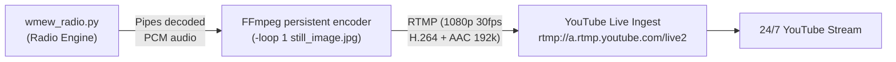

# 24/7 YouTube Livestreaming Guide — WMEW 99.9 FM

This guide walks you through hosting a **24/7 YouTube Livestream** on an Ubuntu server running [`wmew_radio.py`](wmew_radio.py) with [`still_image.jpg`](still_image.jpg) as the 1080p video background.

---

## Architecture Overview



Because [`wmew_radio.py`](wmew_radio.py) keeps a single persistent FFmpeg encoder process open and pipes decoded audio into it, **YouTube never experiences a stream disconnect or buffer reset between tracks**.

---

## Step 1: Set Up YouTube Live Stream

1. Go to **[YouTube Studio](https://studio.youtube.com)**.
2. In the top right, click **Create** $\rightarrow$ **Go Live**.
3. Select **Stream** (left menu).
4. Fill in:
   - **Title**: *e.g. "Mewgenics Radio 24/7 — WMEW 99.9 FM (99.9 Lives)"*
   - **Category**: Gaming $\rightarrow$ *Mewgenics* (or Music / Entertainment)
   - **Visibility**: Public (or Unlisted while testing)
5. Under **Stream Settings**:
   - Copy your **Stream Key** (e.g. `xxxx-xxxx-xxxx-xxxx-xxxx`).
   - Leave **Stream URL** as `rtmp://a.rtmp.youtube.com/live2`.
   - **Stream Latency**: Select **Normal latency** (best for stability and 24/7 radio).
   - Turn **OFF** "Auto-stop" (so YouTube never terminates your broadcast if the server network reconnects).

---

## Step 2: Upload Files to Your Ubuntu Server

From your local machine (PowerShell or Git Bash), copy the `mewgenics_audio` folder to your Ubuntu server:

```powershell
# Using scp (replace 'username' and 'your_server_ip'):
scp -r C:\Users\BruceU\Desktop\mewgenics_audio username@your_server_ip:~/mewgenics_audio
```
*(Alternatively, use an SFTP client like WinSCP, FileZilla, or Cyberduck).*

---

## Step 3: Install Server Dependencies

SSH into your Ubuntu server:

```bash
ssh username@your_server_ip
```

Update packages and install **FFmpeg** and **Python 3**:

```bash
sudo apt update
sudo apt install -y ffmpeg python3
```

Verify installations:
```bash
ffmpeg -version
python3 --version
```

---

## Step 4: Quick Manual Test

Navigate to the uploaded folder:

```bash
cd ~/mewgenics_audio
```

Run a test stream into YouTube (replace `YOUR_STREAM_KEY` with your actual YouTube key):

```bash
python3 wmew_radio.py \
  --stream "rtmp://a.rtmp.youtube.com/live2/YOUR_STREAM_KEY" \
  --loop-visual still_image.jpg
```

- Watch the terminal: you will see the color-coded radio log (Call Letters, Songs, Intros/Outros, Commercials).
- Open **YouTube Studio Live Control Room**: within 10–20 seconds, your stream status will turn green (**"Excellent Connection"**, 1080p 30fps).
- Check the audio and video preview in YouTube Studio.
- Press `Ctrl + C` in the server terminal once verified.

---

## Step 5: Run 24/7 as a Background Service (`systemd`)

Using a `systemd` service ensures your radio stream:
- Starts automatically on server boot / reboot.
- Automatically recovers and restarts if internet drops or YouTube resets.
- Runs silently in the background without needing an open terminal.

### 1. Create a Stream Runner Script

In `~/mewgenics_audio/start_stream.sh`:

```bash
nano ~/mewgenics_audio/start_stream.sh
```

Paste the following (replace `YOUR_STREAM_KEY` with your real YouTube stream key):

```bash
#!/usr/bin/env bash
cd "$(dirname "$0")"

# YouTube RTMP endpoint + Stream Key
STREAM_URL="rtmp://a.rtmp.youtube.com/live2/YOUR_STREAM_KEY"

exec python3 wmew_radio.py \
  --stream "$STREAM_URL" \
  --loop-visual still_image.jpg
```

Make it executable:
```bash
chmod +x ~/mewgenics_audio/start_stream.sh
```

### 2. Create the Systemd Unit File

Create `/etc/systemd/system/wmew-stream.service`:

```bash
sudo nano /etc/systemd/system/wmew-stream.service
```

Paste the following (adjust `User=` and paths if your Ubuntu username is different):

```ini
[Unit]
Description=WMEW 99.9 FM Mewgenics 24/7 YouTube Livestream
After=network-online.target
Wants=network-online.target

[Service]
Type=simple
User=username
WorkingDirectory=/home/username/mewgenics_audio
ExecStart=/home/username/mewgenics_audio/start_stream.sh
Restart=always
RestartSec=5
StandardOutput=journal
StandardError=journal

[Install]
WantedBy=multi-user.target
```

### 3. Enable and Start the Service

```bash
# Reload systemd daemon
sudo systemctl daemon-reload

# Enable service to run on boot, and start it immediately
sudo systemctl enable --now wmew-stream.service
```

---

## Step 6: Managing and Monitoring

### View Live Stream Logs in Real Time
```bash
journalctl -u wmew-stream.service -f
```

### Check Service Status
```bash
sudo systemctl status wmew-stream.service
```

### Stop or Restart the Stream
```bash
# Restart stream:
sudo systemctl restart wmew-stream.service

# Stop stream:
sudo systemctl stop wmew-stream.service
```

---

## Server Resource & Bandwidth Requirements

- **CPU Usage**: Very low (~2–5% of a single modern VPS vCPU). Because `still_image.jpg` is a static image, FFmpeg uses `-tune stillimage` and `-preset veryfast` which requires negligible encoding work.
- **RAM Usage**: ~80–120 MB total (Python + FFmpeg).
- **Upload Bandwidth**: ~2.7 Mbps steady upload:
  - Video: `2500 kbps` (1080p H.264 @ 30fps)
  - Audio: `192 kbps` (AAC Stereo @ 44.1kHz)
- **Monthly Bandwidth Transfer**: ~850 GB – 1 TB / month (easily within standard 2 TB–4 TB VPS bandwidth allowances from providers like Hetzner, DigitalOcean, Linode, or OVH).
